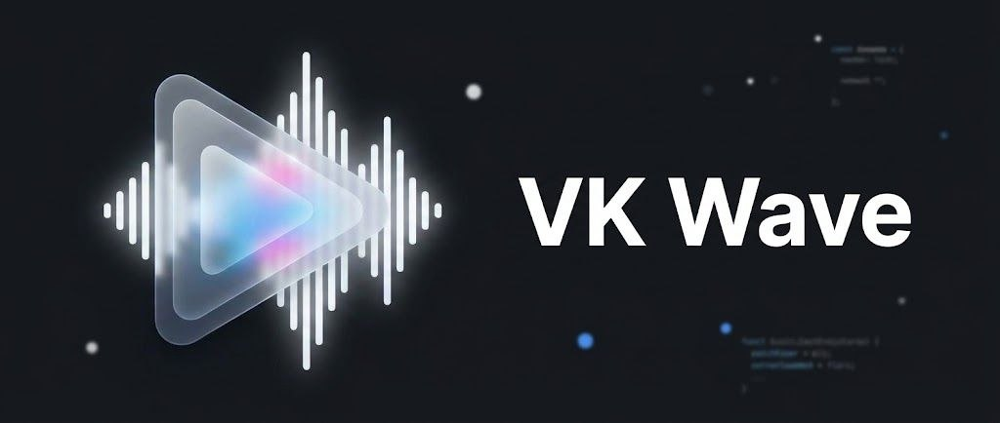

<div align="center">



# 🌊 VK Wave

**Стильный десктоп-клиент для «VK Музыки» с Discord Rich Presence, медиа-клавишами и системным треем.**


[Установка](#-быстрый-старт) • [Discord RPC](#-как-настроить-discord-rich-presence) • [Сборка .exe](#-сборка-в-exe) • [Лицензия](#-лицензия)

</div>

## 📖 О проекте

**VK Wave** — лёгкая Electron-обёртка над веб-версией **vk.com/music**, которая превращает браузерный плеер в полноценное десктопное приложение: нативное тёмное окно без белой рамки Windows, управление из системного трея, аппаратные медиа-клавиши и живой статус в Discord с обложкой трека и прогресс-баром.

## ✨ Возможности

- 🎧 **Музыка VK в отдельном окне** — никакой лишней вкладки браузера, нативное тёмное оформление с `titleBarOverlay` (#141414, белые кнопки управления окном).
- 🎮 **Discord Rich Presence** — название трека, исполнитель, обложка, иконка play/pause, живой прогресс-бар и две кнопки: «Слушать в VK Музыке» и «Скачать VK Wave».
- ⌨️ **Медиа-клавиши и оверлей Windows 10/11** — Play/Pause/Next/Prev с клавиатуры и наушников через MediaSession API Chromium, нативный медиа-оверлей ОС с обложкой.
- 📌 **Системный трей** — крестик сворачивает приложение в трей (а не закрывает), контекстное меню: Слушать/Пауза, Следующий/Предыдущий трек, Настройки, Развернуть, Выход.
- 🎵 **Режим «Только музыка»** — любые переходы вне музыкального раздела ВК автоматически возвращают в плеер, лишние блоки интерфейса скрываются.
- 🎨 **Кастом-темы** — панель настроек (`Ctrl+Shift+T`): фон, карточки, акцент, скругления, пресеты OLED/Midnight/Light, импорт/экспорт темы.
- 🎹 **Хоткеи и автозапуск** — `Space` (пауза), `Ctrl+←/→` (треки), старт с Windows и запуск свёрнутым в трее.
- 🔐 **Сохранение сессии** — cookies хранятся в изолированном разделе `persist:vkwave`, логиниться нужно всего один раз.
- 🔁 **Автопереподключение к Discord** — если клиент Discord закрыли, VK Wave сам переподключается каждые 15 секунд.
- 🚀 **Один экземпляр приложения** — повторный запуск просто разворачивает уже открытое окно.
- 🛡 **Безопасность** — `contextIsolation`, без `nodeIntegration`; внешние ссылки открываются в системном браузере.

## ⚠️ Важное примечание про подписку

VK Wave — это **удобная десктопная обёртка** с Discord RPC и системной интеграцией. Клиент **не обходит** серверные ограничения VK: рекламу, лимиты прослушиваний и прочие условия определяет сам ВК на своей стороне.

Для комфортного прослушивания без ограничений (неограниченные прослушивания, фоновый режим, офлайн) рекомендуется активная подписка **VK Музыка / VK Mix**. VK Wave лишь делает использование подписки приятнее на десктопе.

> Проект не аффилирован с ООО «ВК» и не является официальным клиентом.

## 🧩 Архитектура

```
vk-wave/
├── assets/          # hero.jpg (баннер README), logo.png / logo.ico (иконка)
├── main.js          # Главный процесс: окно, titleBarOverlay, трей, IPC, сессия
├── preload.js       # Перехватчик плеера, темы, панель настроек, хоткеи
├── discord.js       # Discord Rich Presence (@xhayper/discord-rpc)
├── package.json     # Зависимости и конфиг electron-builder
└── README.md
```

Как это работает: `preload.js` в изолированном контексте страницы читает состояние плеера (название, исполнитель, обложка, пауза, время) и через `ipcRenderer.send('track-update', …)` передаёт его в `main.js`, который обновляет Discord-присутствие и меню трея. Команды из трея и медиа-клавиши идут обратным путём и «нажимают» кнопки плеера VK.

## 🚀 Быстрый старт

**Требования:** [Node.js](https://nodejs.org/) 18+ и Git.

```bash
# 1. Клонируем репозиторий
git clone https://github.com/mitherly/VK-Wave.git
cd vk-wave

# 2. Устанавливаем зависимости
npm install

# 3. Запускаем
npm start
```

При первом запуске войдите в аккаунт VK в открывшемся окне — сессия сохранится, и в следующий раз VK Wave откроется сразу с музыкой.

## 🎨 Настройки и темы

Откройте панель: **`Ctrl+Shift+T`** или правый клик по иконке в трее → **Настройки**.

| Что настраивается | Как |
| --- | --- |
| Тема | Пресеты **VK Dark / OLED / Midnight / Light** или свои цвета: фон окна, карточки, акцент, скругления |
| Только музыка | Любая навигация вне раздела музыки возвращает в плеер, левое меню и баннеры ВК скрываются |
| Хоткеи | `Space` — пауза, `Ctrl+←` / `Ctrl+→` — предыдущий/следующий трек (не срабатывают при фокусе в поле поиска — так задумано) |
| Автозапуск | «Запускать с Windows» (для установленной версии) и «Стартовать в трее» |

Тема красит интерфейс ВК через дизайн-токены VKUI и применяется мгновенно; рамка окна перекрашивается следом. Кнопки **«Копировать тему» / «Вставить»** переносят тему через буфер обмена — удобно делиться JSON-конфигом. Настройки лежат в `userData/settings.json`.

## 🎮 Как настроить свой Discord Rich Presence

1. Зайдите на [Discord Developer Portal](https://discord.com/developers/applications) и нажмите **New Application**.
2. Задайте имя приложения — **VK Wave** (оно будет отображаться в профиле как название «игры») — и сохраните.
3. На вкладке **General Information** скопируйте **Application ID**.
4. Откройте файл `discord.js` и вставьте ID вместо заглушки:

   ```js
   const CLIENT_ID = 'ВАШ_APPLICATION_ID';
   ```

5. Иконки и логотип **работают сразу** — discord.js передаёт их в Discord внешними URL из репозитория (это официально поддерживается Rich Presence). Загрузка ассетов в портал **не требуется**.

   Хотите видеть арты в хранилище своего приложения (Rich Presence → Art Assets)? Два способа:

   **Скриптом:** возьмите токен бота (вкладка **Bot** → *Reset Token*) и выполните:

   ```bash
   # Windows (cmd)
   set DISCORD_BOT_TOKEN=ваш_токен && npm run upload:assets

   # PowerShell
   $env:DISCORD_BOT_TOKEN="ваш_токен"; npm run upload:assets

   # Linux/macOS
   DISCORD_BOT_TOKEN=ваш_токен npm run upload:assets
   ```

   Скрипт зальёт `logo`, `play`, `pause`; повторный запуск безопасен. ⚠️ Токен нигде не публикуйте и не коммитьте.

   **Или вручную:** вкладка **Rich Presence → Art Assets** → загрузите `assets/logo.png`, `assets/play.png`, `assets/pause.png` под соответствующими ключами.

   > Обложка текущего трека подхватывается автоматически — прямой ссылкой, загружать её не нужно.
6. Перезапустите VK Wave. **Клиент Discord должен быть запущен.**

Готово — откройте свой профиль в Discord и наслаждайтесь видом 🎶

## 📦 Сборка в .exe

Сборка выполняется через [electron-builder](https://www.electron.build/):

```bash
# Установщик NSIS (dist/VK Wave Setup 1.0.0.exe)
npm run dist

# Портативная версия (один .exe без установки)
npm run dist:portable
```

Готовый файл появится в папке `dist/`. Конфигурация сборки (иконка, цели Windows/Linux/macOS) лежит в секции `build` файла `package.json`.

## 🛠 Возможные проблемы

| Проблема | Решение |
| --- | --- |
| Статус в Discord не появляется | Нужен **десктопный** Discord. В настройках Discord → «Конфиденциальность» должна быть включена **демонстрация текущей активности**. Запустите `npm start` и посмотрите строки `[VK Wave · Discord]` в терминале: «Подключено…» + «Присутствие отправлено» значат, что проблема на стороне настроек Discord. |
| В профиле нет обложки/иконок play-pause | Загрузите арты `logo`, `play`, `pause` в Discord Developer Portal (шаг 5 гайда выше). Обложка трека появляется автоматически после первого трека. |
| Discord закрылся — статус пропал | Это нормально: VK Wave сам переподключится в течение 15 секунд после запуска Discord. |
| Не сохраняется вход в VK | Не удаляйте папку `appdata` профиля Electron (`persist:vkwave` хранит сессию). |
| Медиа-клавиши не работают | Нажмите play в самом приложении один раз — Chromium зарегистрирует сессию в ОС. |
| После включения «Только музыка» что-то выглядит сломанным | Выключите тумблер в панели (`Ctrl+Shift+T`) — CSS-скрытие не под все версии DOM ВК. Редирект и скрытие — независимые переключатели логики, панель всегда доступна. |

## 🤝 Участие в проекте

PR и идеи приветствуются! Перед пул-реквестом проверьте, что `npm start` работает, а код соответствует существующему стилю.

## 📄 Лицензия

Проект распространяется по лицензии [MIT](LICENSE).

---

<div align="center">

**VK Wave** — сделано с 🌊 и Electron. Не является официальным продуктом VK.

</div>
